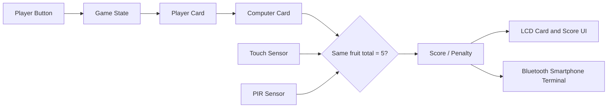

# STM32 Halli Galli Game System

4인 팀으로 STM32 기반 1인 대 컴퓨터 할리갈리 게임을 구현한 임베디드 프로젝트입니다. 센서 입력, LCD·Bluetooth 출력, 게임 상태 통합과 디버깅·테스트에 참여했습니다.

## 프로젝트 개요

| 항목 | 내용 |
|---|---|
| 형태 | 4인 학부 팀 프로젝트 |
| 결과 | 최종 하드웨어 시연 및 과제 통과 |
| 개인 기여 | LCD·스마트폰 인터페이스, 코드 최적화, 디버깅, 테스트, 하드웨어 설계 |
| 기술 | C, STM32F10x, GPIO, Timer, 버튼, 터치·PIR 센서, LCD, Bluetooth |

## 시스템 구성

버튼을 누르면 플레이어와 컴퓨터의 무작위 과일 카드가 LCD에 차례로 표시됩니다. 같은 과일의 합이 5일 때 터치센서로 종을 치고, 조건을 만족하지 않은 접근은 PIR 센서로 감지해 감점합니다. 점수와 최종 결과는 LCD와 Bluetooth 스마트폰 터미널에 출력합니다.

세부 흐름은 [Architecture](docs/ARCHITECTURE.md)에서 확인할 수 있습니다.

## 개인 기여

- 무작위 카드와 점수·결과를 표시하는 LCD 인터페이스 구성
- 게임 결과를 스마트폰 터미널에 출력하는 흐름 구성·점검
- breadboard 부품 배치와 하드웨어 연결 설계
- 점수 계산, 버튼 입력과 게임 진행 오류의 반복 재현·수정
- 게임 난이도와 진행 순서 조정, 최종 통합 테스트
- 팀 진행 상황 공유와 마감 직전 통합·디버깅 참여

[구체적인 담당 범위](docs/CONTRIBUTION.md) · [협업 과정](docs/COLLABORATION.md)

## 대표 문제 해결

### 하드웨어 제약에 맞춘 범위 조정

초기 4인 플레이 구상은 포트 수와 안정성 제약이 있었습니다. 버튼 입력, 무작위 카드, 터치 판정과 점수라는 핵심 경험을 유지하면서 1인 대 컴퓨터 구조로 범위를 조정해 시연 안정성을 높였습니다.

### PIR 센서 위치와 판정 방식 개선

정지한 손을 계속 감지하는 방식 대신 손의 대기 위치와 터치센서 사이에 PIR 센서를 배치했습니다. 조건을 만족하지 않은 상태에서 종으로 접근하는 움직임을 감지해 감점 규칙과 연결했습니다.

### 마감 직전 전체 흐름 안정화

실습실에서만 하드웨어 검증이 가능한 상황에서 전체 게임 흐름을 먼저 파악하고, 발표 전날 팀원들과 점수 오계산·버튼 입력 후 진행 정지·무반응 문제를 반복 재현했습니다. 기능 추가보다 카드 출력, 입력, 점수와 결과 출력의 연결을 우선해 최종 시연을 완료했습니다.

세부 과정은 [Problem Solving](docs/PROBLEM_SOLVING.md)에 정리했습니다.

## 대표 코드

현재 남아 있는 코드는 전체 통합본이 아니라 프로젝트 과정에서 작성한 독립 센서 모듈입니다.

| 코드 | 확인할 내용 |
|---|---|
| [`touch_sensor_original.c`](src/preserved-modules/touch_sensor_original.c) | GPIO 기반 터치 입력과 출력 제어 |
| [`ultrasonic_sensor_original.c`](src/preserved-modules/ultrasonic_sensor_original.c) | GPIO Trigger와 TIM2 counter를 이용한 Echo 시간 측정 |

[출처와 저작권](docs/COPYRIGHT.md) · [자료 구성](docs/ORIGINAL_REVIEW.md)
